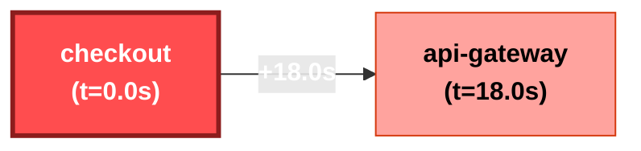

# Incident Investigation Report: INC-2357BB
**Scenario**: `03_bad_deploy`  
**Generated**: `2026-11-06 19:50:14 UTC`  
**Overall Severity**: `CRITICAL` (Base: Critical, LLM Adj: +0)  
**Primary Root Cause**: `checkout`  
**Investigation Confidence**: `97.0%`

---

## 1. Executive Summary
Incident investigation identified root cause in service **`checkout`** (Primary Root Cause: Bad Deployment in `checkout`). Cascading failures propagated through 2 services. Adversarial verification determined hypothesis confidence of **97.0%** with all cited claims grounded in verified log entries.

## 2. Hybrid Severity Breakdown
A defensible weighted calculation based on system telemetry and blast impact:

| Factor | Weight | Score | Description |
| :--- | :---: | :---: | :--- |
| **Availability Impact** | 35% | 1.00 | Service downtime vs degraded operation |
| **Blast Radius** | 25% | 0.90 | Number & criticality of affected services |
| **Error Rate & Trend** | 20% | 1.00 | Peak error spike ratio and trajectory |
| **User-Facing Path** | 20% | 1.00 | Customer ingress path vs internal batch |
| **Composite Base Score** | 100% | **0.975** | Mapped Band: **Critical** |
| **Final Severity** | - | **Critical** | Justification: Deterministic formula calculated score 0.975 (Critical) based on: Availability=1.00 (35%), Blast Radius=0.90 (25%), Error Rate=1.00 (20%), User-Facing=1.00 (20%). |

## 3. Innovation 1: Auto-inferred Causal Propagation Graph
Inferred propagation graph derived from anomaly onset timestamps and inter-service error citations:

### Blast Radius Timeline
| Order | Service | Onset Timestamp | Lag from Root | Status |
| :---: | :--- | :--- | :---: | :--- |
| checkout | `checkout` | `2026-11-07T10:00:12` | +0.0s | **ROOT CAUSE** |
| api-gateway | `api-gateway` | `2026-11-07T10:00:30` | +18.0s | Cascading Cascade |

## 4. Innovation 2: Hypothesis Tournament with Adversarial Verifier
To prevent LLM confirmation bias, competing hypotheses were evaluated by an adversarial verification agent:

### H1: Primary Root Cause: Bad Deployment in `checkout` [SUPPORTED]
- **Candidate Service**: `checkout`
- **Description**: Failure initiated in `checkout` due to internal fault, propagating downstream to other services.
- **Testable Predictions**:
  - `checkout` anomaly onset timestamp must strictly precede downstream errors.
  - `checkout` log entries must show intrinsic fatal errors or resource exhaustion.
  - Downstream service error logs must reference connection or timeout failures to `checkout`.
- **Outcome & Evidence**: Strongly supported: Earliest onset verified with 2 intrinsic failure events. Downstream services corroborate dependency failure.
- **Confirming Citations**: L-0001, L-0003, L-0004, L-0006
- **Refuting Citations**: None

### H2: Alternative Hypothesis: Independent Failure in `api-gateway` [REFUTED]
- **Candidate Service**: `api-gateway`
- **Description**: Failure originated independently in `api-gateway` (SERVICE_ERROR) and was not a mere cascade from `checkout`.
- **Testable Predictions**:
  - `api-gateway` errors must begin prior to or independent of `checkout`.
  - `api-gateway` error logs should not reference `checkout` timeouts as trigger.
  - `api-gateway` must exhibit autonomous internal crash without upstream dependency failure.
- **Outcome & Evidence**: Refuted as primary root cause: Error onset in `api-gateway` occurred +18.0s after `checkout`. Logs in `api-gateway` explicitly document cascading upstream failures from `checkout`.
- **Confirming Citations**: None
- **Refuting Citations**: L-0006

## 5. 'Why Not X?' Competitive Hypothesis Analysis
Detailed rationale refuting alternative or decoy root causes:

- **Why Not `api-gateway` (Alternative Hypothesis: Independent Failure in `api-gateway`)?**
  - **Finding**: Refuted as primary root cause: Error onset in `api-gateway` occurred +18.0s after `checkout`. Logs in `api-gateway` explicitly document cascading upstream failures from `checkout`.
  - **Disproving Citations**: L-0006

## 6. Grounded Evidence Citations
Every conclusion in this report links directly to immutable source log lines:

| Citation ID | Timestamp | Service | Level | Raw Excerpt |
| :---: | :--- | :--- | :---: | :--- |
| **`L-0001`** | `10:00:00` | `deploy-service` | `INFO` | Deployment rollout started for checkout service version v2.4.1 |
| **`L-0003`** | `10:00:12` | `checkout` | `ERROR` | ImportError: cannot import name 'calculate_tax_v2' from 'tax_engine' in v2.4.1 |
| **`L-0004`** | `10:00:16` | `checkout` | `ERROR` | HTTP 500 unhandled exception on POST /checkout/process |
| **`L-0005`** | `10:00:22` | `checkout` | `CRITICAL` | Startup health check probe failed for checkout deployment v2.4.1 |
| **`L-0006`** | `10:00:30` | `api-gateway` | `ERROR` | Upstream checkout returned HTTP 500 Internal Server Error |

## 7. RAG-Retrieved Remediation Runbook
**Matched Runbook**: `RB-003` - **Bad Deployment / Release Rollback** (Category: `DEPLOYMENT`)

### Prescribed Remediation Actions (Requires Human Sign-off):
1. Immediately execute deployment rollback to previous stable tag: `kubectl rollout undo deployment/<service-name>`
2. Invalidate deployment lock and stop ongoing CI/CD pipelines.
3. Verify previous stable image pods reach Ready 1/1 state.
4. Engage release author to triage faulty commit diff.

### Verification & Recovery Criteria:
- Confirm error rate drops back to baseline (< 0.1%)
- Verify deployment revision matches last known stable hash

## 8. Historical Incident Memory (RAG)
No prior matching incidents in incident memory.

## 9. Governance & Action Status
- **Action Policy**: *Recommend-only*. Automated remediation requires human SRE authorization.
- **Human Approval Status**: `PENDING APPROVAL` ⏸️
- **Audit Trail**: Every guardrail check, tool dispatch, and LLM reasoning step logged to `outputs/audit.log`.
