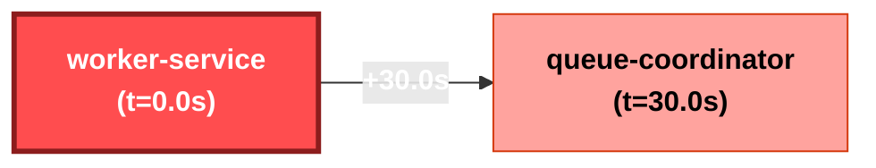

# Incident Investigation Report: INC-24B0C6
**Scenario**: `02_memory_leak`  
**Generated**: `2026-11-07 01:51:31 UTC`  
**Overall Severity**: `HIGH` (Base: High, LLM Adj: +0)  
**Primary Root Cause**: `worker-service`  
**Investigation Confidence**: `97.0%`

---

## 1. Executive Summary
Incident investigation identified root cause in service **`worker-service`** (Primary Root Cause: Memory Leak Oom in `worker-service`). Cascading failures propagated through 2 services. Adversarial verification determined hypothesis confidence of **97.0%** with all cited claims grounded in verified log entries.

## 2. Hybrid Severity Breakdown
A defensible weighted calculation based on system telemetry and blast impact:

| Factor | Weight | Score | Description |
| :--- | :---: | :---: | :--- |
| **Availability Impact** | 35% | 1.00 | Service downtime vs degraded operation |
| **Blast Radius** | 25% | 0.50 | Number & criticality of affected services |
| **Error Rate & Trend** | 20% | 1.00 | Peak error spike ratio and trajectory |
| **User-Facing Path** | 20% | 0.35 | Customer ingress path vs internal batch |
| **Composite Base Score** | 100% | **0.745** | Mapped Band: **High** |
| **Final Severity** | - | **High** | Justification: Deterministic formula calculated score 0.745 (High) based on: Availability=1.00 (35%), Blast Radius=0.50 (25%), Error Rate=1.00 (20%), User-Facing=0.35 (20%). |

## 3. Innovation 1: Auto-inferred Causal Propagation Graph
Inferred propagation graph derived from anomaly onset timestamps and inter-service error citations:

### Blast Radius Timeline
| Order | Service | Onset Timestamp | Lag from Root | Status |
| :---: | :--- | :--- | :---: | :--- |
| worker-service | `worker-service` | `2026-11-07T10:00:45` | +0.0s | **ROOT CAUSE** |
| queue-coordinator | `queue-coordinator` | `2026-11-07T10:01:15` | +30.0s | Cascading Cascade |

## 4. Innovation 2: Hypothesis Tournament with Adversarial Verifier
To prevent LLM confirmation bias, competing hypotheses were evaluated by an adversarial verification agent:

### H1: Primary Root Cause: Memory Leak Oom in `worker-service` [SUPPORTED]
- **Candidate Service**: `worker-service`
- **Description**: Failure initiated in `worker-service` due to internal fault, propagating downstream to other services.
- **Testable Predictions**:
  - `worker-service` anomaly onset timestamp must strictly precede downstream errors.
  - `worker-service` log entries must show intrinsic fatal errors or resource exhaustion.
  - Downstream service error logs must reference connection or timeout failures to `worker-service`.
- **Outcome & Evidence**: Strongly supported: Earliest onset verified with 1 intrinsic failure events. Downstream services corroborate dependency failure.
- **Confirming Citations**: L-0004
- **Refuting Citations**: None

### H2: Alternative Hypothesis: Independent Failure in `queue-coordinator` [REFUTED]
- **Candidate Service**: `queue-coordinator`
- **Description**: Failure originated independently in `queue-coordinator` (SERVICE_ERROR) and was not a mere cascade from `worker-service`.
- **Testable Predictions**:
  - `queue-coordinator` errors must begin prior to or independent of `worker-service`.
  - `queue-coordinator` error logs should not reference `worker-service` timeouts as trigger.
  - `queue-coordinator` must exhibit autonomous internal crash without upstream dependency failure.
- **Outcome & Evidence**: Refuted as primary root cause: Error onset in `queue-coordinator` occurred +30.0s after `worker-service`. Logs in `queue-coordinator` explicitly document cascading upstream failures from `worker-service`.
- **Confirming Citations**: None
- **Refuting Citations**: L-0006

## 5. 'Why Not X?' Competitive Hypothesis Analysis
Detailed rationale refuting alternative or decoy root causes:

- **Why Not `queue-coordinator` (Alternative Hypothesis: Independent Failure in `queue-coordinator`)?**
  - **Finding**: Refuted as primary root cause: Error onset in `queue-coordinator` occurred +30.0s after `worker-service`. Logs in `queue-coordinator` explicitly document cascading upstream failures from `worker-service`.
  - **Disproving Citations**: L-0006

## 6. Grounded Evidence Citations
Every conclusion in this report links directly to immutable source log lines:

| Citation ID | Timestamp | Service | Level | Raw Excerpt |
| :---: | :--- | :--- | :---: | :--- |
| **`L-0004`** | `10:00:45` | `worker-service` | `ERROR` | java.lang.OutOfMemoryError: Java heap space. Memory leak in batch queue. |
| **`L-0005`** | `10:01:00` | `worker-service` | `FATAL` | Container terminated with SIGKILL (Exit Code 137, OOMKilled). |
| **`L-0006`** | `10:01:15` | `queue-coordinator` | `ERROR` | Heartbeat lost for worker-service instance-04. Marking node as dead. |

## 7. RAG-Retrieved Remediation Runbook
**Matched Runbook**: `RB-002` - **Worker Process Heap Memory Leak & OOM Crash** (Category: `MEMORY`)

### Prescribed Remediation Actions (Requires Human Sign-off):
1. Trigger an on-demand heap dump before container recycling if diagnostics enabled.
2. Perform graceful rolling restart of the affected worker deployment.
3. Temporarily increase container memory limit by 50% in Kubernetes deployment manifest.
4. Roll back recent commits touching in-memory caches or object references.

### Verification & Recovery Criteria:
- Monitor resident set size (RSS) memory stabilization after restart
- Ensure container restart count stops incrementing

## 8. Historical Incident Memory (RAG)
- **Incident `INC-009`**: Async batch worker memory leak
  - **Root Cause**: `worker-service` - Unbounded cache in batch processing caused heap exhaustion and container SIGKILL (OOMKilled).
  - **Resolution**: Resolved by clearing cache references, restarting worker deployment, and increasing memory limit by 1GiB.
  - **Similarity Score**: `0.52`

## 9. Governance & Action Status
- **Action Policy**: *Recommend-only*. Automated remediation requires human SRE authorization.
- **Human Approval Status**: `PENDING APPROVAL` ⏸️
- **Audit Trail**: Every guardrail check, tool dispatch, and LLM reasoning step logged to `outputs/audit.log`.
