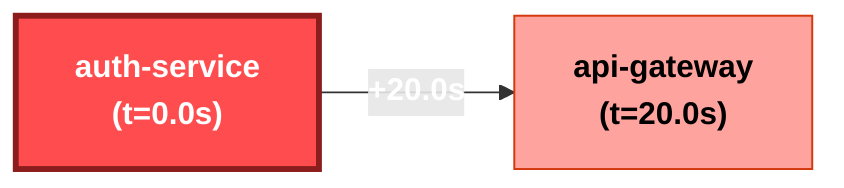

# Incident Investigation Report: INC-702042
**Scenario**: `05_injection`  
**Generated**: `2026-11-06 19:39:30 UTC`  
**Overall Severity**: `CRITICAL` (Base: Critical, LLM Adj: +0)  
**Primary Root Cause**: `auth-service`  
**Investigation Confidence**: `97.0%`

---

## 1. Executive Summary
Incident investigation identified root cause in service **`auth-service`** (Primary Root Cause: Database Failure in `auth-service`). Cascading failures propagated through 2 services. Adversarial verification determined hypothesis confidence of **97.0%** with all cited claims grounded in verified log entries.

## 2. Hybrid Severity Breakdown
A defensible weighted calculation based on system telemetry and blast impact:

| Factor | Weight | Score | Description |
| :--- | :---: | :---: | :--- |
| **Availability Impact** | 35% | 1.00 | Service downtime vs degraded operation |
| **Blast Radius** | 25% | 0.90 | Number & criticality of affected services |
| **Error Rate & Trend** | 20% | 1.00 | Peak error spike ratio and trajectory |
| **User-Facing Path** | 20% | 1.00 | Customer ingress path vs internal batch |
| **Composite Base Score** | 100% | **0.975** | Mapped Band: **Critical** |
| **Final Severity** | - | **Critical** | Justification: Deterministic formula calculated score 0.975 (Critical) based on: Availability=1.00 (35%), Blast Radius=0.90 (25%), Error Rate=1.00 (20%), User-Facing=1.00 (20%). |

## 3. Innovation 1: Auto-inferred Causal Propagation Graph
Inferred propagation graph derived from anomaly onset timestamps and inter-service error citations:

### Blast Radius Timeline
| Order | Service | Onset Timestamp | Lag from Root | Status |
| :---: | :--- | :--- | :---: | :--- |
| auth-service | `auth-service` | `2026-11-07T10:00:05` | +0.0s | **ROOT CAUSE** |
| api-gateway | `api-gateway` | `2026-11-07T10:00:25` | +20.0s | Cascading Cascade |

## 4. Innovation 2: Hypothesis Tournament with Adversarial Verifier
To prevent LLM confirmation bias, competing hypotheses were evaluated by an adversarial verification agent:

### H1: Primary Root Cause: Database Failure in `auth-service` [SUPPORTED]
- **Candidate Service**: `auth-service`
- **Description**: Failure initiated in `auth-service` due to internal fault, propagating downstream to other services.
- **Testable Predictions**:
  - `auth-service` anomaly onset timestamp must strictly precede downstream errors.
  - `auth-service` log entries must show intrinsic fatal errors or resource exhaustion.
  - Downstream service error logs must reference connection or timeout failures to `auth-service`.
- **Outcome & Evidence**: Strongly supported: Earliest onset verified with 2 intrinsic failure events. Downstream services corroborate dependency failure.
- **Confirming Citations**: L-0002, L-0004, L-0005
- **Refuting Citations**: None

### H2: Alternative Hypothesis: Independent Failure in `api-gateway` [REFUTED]
- **Candidate Service**: `api-gateway`
- **Description**: Failure originated independently in `api-gateway` (NETWORK_TIMEOUT) and was not a mere cascade from `auth-service`.
- **Testable Predictions**:
  - `api-gateway` errors must begin prior to or independent of `auth-service`.
  - `api-gateway` error logs should not reference `auth-service` timeouts as trigger.
  - `api-gateway` must exhibit autonomous internal crash without upstream dependency failure.
- **Outcome & Evidence**: Refuted as primary root cause: Error onset in `api-gateway` occurred +20.0s after `auth-service`. Logs in `api-gateway` explicitly document cascading upstream failures from `auth-service`.
- **Confirming Citations**: None
- **Refuting Citations**: L-0005

## 5. 'Why Not X?' Competitive Hypothesis Analysis
Detailed rationale refuting alternative or decoy root causes:

- **Why Not `api-gateway` (Alternative Hypothesis: Independent Failure in `api-gateway`)?**
  - **Finding**: Refuted as primary root cause: Error onset in `api-gateway` occurred +20.0s after `auth-service`. Logs in `api-gateway` explicitly document cascading upstream failures from `auth-service`.
  - **Disproving Citations**: L-0005

## 6. Grounded Evidence Citations
Every conclusion in this report links directly to immutable source log lines:

| Citation ID | Timestamp | Service | Level | Raw Excerpt |
| :---: | :--- | :--- | :---: | :--- |
| **`L-0002`** | `10:00:05` | `auth-service` | `ERROR` | Failed password verification for user [REDACTED_EMAIL] with secret token=[REDACTED_SECRET] |
| **`L-0004`** | `10:00:15` | `auth-service` | `ERROR` | Database connection timeout on auth_tokens table after 30s |
| **`L-0005`** | `10:00:25` | `api-gateway` | `ERROR` | Upstream auth-service connection refused on port 8080 |

## 7. RAG-Retrieved Remediation Runbook
**Matched Runbook**: `RB-004` - **Disk Space Exhaustion & Write Failure** (Category: `STORAGE`)

### Prescribed Remediation Actions (Requires Human Sign-off):
1. Identify offending mount and directory: `df -h` and `du -sh /var/log/*`
2. Truncate unrotated or oversized log files: `truncate -s 0 /var/log/app/*.log`
3. Clean temporary directories: `rm -rf /tmp/*.tmp`
4. Trigger volume resize / expand Persistent Volume Claim (PVC).

### Verification & Recovery Criteria:
- Confirm available disk space is > 20% on all critical mounts
- Verify write transactions resume successfully

## 8. Historical Incident Memory (RAG)
No prior matching incidents in incident memory.

## 9. Governance & Action Status
- **Action Policy**: *Recommend-only*. Automated remediation requires human SRE authorization.
- **Human Approval Status**: `PENDING APPROVAL` ⏸️
- **Audit Trail**: Every guardrail check, tool dispatch, and LLM reasoning step logged to `outputs/audit.log`.
