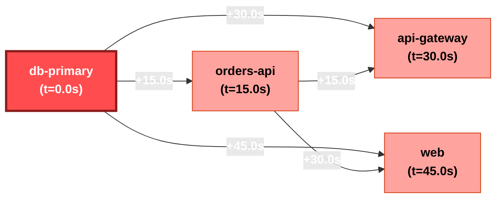

# Incident Investigation Report: INC-AE2B18
**Scenario**: `01_db_failure`  
**Generated**: `2026-11-06 19:50:14 UTC`  
**Overall Severity**: `CRITICAL` (Base: Critical, LLM Adj: +0)  
**Primary Root Cause**: `db-primary`  
**Investigation Confidence**: `97.0%`

---

## 1. Executive Summary
Incident investigation identified root cause in service **`db-primary`** (Primary Root Cause: Database Failure in `db-primary`). Cascading failures propagated through 4 services. Adversarial verification determined hypothesis confidence of **97.0%** with all cited claims grounded in verified log entries.

## 2. Hybrid Severity Breakdown
A defensible weighted calculation based on system telemetry and blast impact:

| Factor | Weight | Score | Description |
| :--- | :---: | :---: | :--- |
| **Availability Impact** | 35% | 1.00 | Service downtime vs degraded operation |
| **Blast Radius** | 25% | 1.00 | Number & criticality of affected services |
| **Error Rate & Trend** | 20% | 1.00 | Peak error spike ratio and trajectory |
| **User-Facing Path** | 20% | 1.00 | Customer ingress path vs internal batch |
| **Composite Base Score** | 100% | **1.000** | Mapped Band: **Critical** |
| **Final Severity** | - | **Critical** | Justification: Deterministic formula calculated score 1.000 (Critical) based on: Availability=1.00 (35%), Blast Radius=1.00 (25%), Error Rate=1.00 (20%), User-Facing=1.00 (20%). |

## 3. Innovation 1: Auto-inferred Causal Propagation Graph
Inferred propagation graph derived from anomaly onset timestamps and inter-service error citations:

### Blast Radius Timeline
| Order | Service | Onset Timestamp | Lag from Root | Status |
| :---: | :--- | :--- | :---: | :--- |
| db-primary | `db-primary` | `2026-11-07T10:00:00` | +0.0s | **ROOT CAUSE** |
| orders-api | `orders-api` | `2026-11-07T10:00:15` | +15.0s | Cascading Cascade |
| api-gateway | `api-gateway` | `2026-11-07T10:00:30` | +30.0s | Cascading Cascade |
| web | `web` | `2026-11-07T10:00:45` | +45.0s | Cascading Cascade |

## 4. Innovation 2: Hypothesis Tournament with Adversarial Verifier
To prevent LLM confirmation bias, competing hypotheses were evaluated by an adversarial verification agent:

### H1: Primary Root Cause: Database Failure in `db-primary` [SUPPORTED]
- **Candidate Service**: `db-primary`
- **Description**: Failure initiated in `db-primary` due to internal fault, propagating downstream to other services.
- **Testable Predictions**:
  - `db-primary` anomaly onset timestamp must strictly precede downstream errors.
  - `db-primary` log entries must show intrinsic fatal errors or resource exhaustion.
  - Downstream service error logs must reference connection or timeout failures to `db-primary`.
- **Outcome & Evidence**: Strongly supported: Earliest onset verified with 1 intrinsic failure events. Downstream services corroborate dependency failure.
- **Confirming Citations**: L-0002, L-0003, L-0004
- **Refuting Citations**: None

### H2: Alternative Hypothesis: Independent Failure in `orders-api` [REFUTED]
- **Candidate Service**: `orders-api`
- **Description**: Failure originated independently in `orders-api` (DATABASE_FAILURE) and was not a mere cascade from `db-primary`.
- **Testable Predictions**:
  - `orders-api` errors must begin prior to or independent of `db-primary`.
  - `orders-api` error logs should not reference `db-primary` timeouts as trigger.
  - `orders-api` must exhibit autonomous internal crash without upstream dependency failure.
- **Outcome & Evidence**: Refuted as primary root cause: Error onset in `orders-api` occurred +15.0s after `db-primary`. Logs in `orders-api` explicitly document cascading upstream failures from `db-primary`.
- **Confirming Citations**: None
- **Refuting Citations**: L-0003, L-0004

### H3: Decoy / Concurrent Incident: Transient Fault in `api-gateway` [REFUTED]
- **Candidate Service**: `api-gateway`
- **Description**: `api-gateway` failure is the true root driver, or is an unrelated noisy background symptom.
- **Testable Predictions**:
  - `api-gateway` errors must persist and correlate directly with end-user degradation.
  - Mitigating `api-gateway` would restore end-to-end service availability.
- **Outcome & Evidence**: Refuted: Temporal onset lag (+30.0s) indicates `api-gateway` is a downstream consequence, not root trigger.
- **Confirming Citations**: None
- **Refuting Citations**: L-0005, L-0006

## 5. 'Why Not X?' Competitive Hypothesis Analysis
Detailed rationale refuting alternative or decoy root causes:

- **Why Not `orders-api` (Alternative Hypothesis: Independent Failure in `orders-api`)?**
  - **Finding**: Refuted as primary root cause: Error onset in `orders-api` occurred +15.0s after `db-primary`. Logs in `orders-api` explicitly document cascading upstream failures from `db-primary`.
  - **Disproving Citations**: L-0003, L-0004

- **Why Not `api-gateway` (Decoy / Concurrent Incident: Transient Fault in `api-gateway`)?**
  - **Finding**: Refuted: Temporal onset lag (+30.0s) indicates `api-gateway` is a downstream consequence, not root trigger.
  - **Disproving Citations**: L-0005, L-0006

## 6. Grounded Evidence Citations
Every conclusion in this report links directly to immutable source log lines:

| Citation ID | Timestamp | Service | Level | Raw Excerpt |
| :---: | :--- | :--- | :---: | :--- |
| **`L-0001`** | `10:00:00` | `db-primary` | `CRITICAL` | FATAL: remaining connection slots are reserved for non-replication superuser connections (max_connections=500 reached) |
| **`L-0002`** | `10:00:05` | `db-primary` | `ERROR` | Connection pool exhausted: active_connections=500, waiting_clients=84, pool_timeout=30s |
| **`L-0003`** | `10:00:15` | `orders-api` | `ERROR` | Timeout acquiring connection to upstream db-primary after 15000ms. Aborting transaction. |
| **`L-0004`** | `10:00:20` | `orders-api` | `ERROR` | Failed to execute query on db-primary: connection pool timeout |
| **`L-0005`** | `10:00:30` | `api-gateway` | `ERROR` | HTTP 504 Gateway Timeout: upstream orders-api connection timed out after 30s |
| **`L-0006`** | `10:00:35` | `api-gateway` | `ERROR` | Egress failure: orders-api health check failing consecutive attempts |
| **`L-0007`** | `10:00:45` | `web` | `ERROR` | HTTP 500 Internal Server Error returned to user while rendering /orders checkout flow |
| **`L-0008`** | `10:00:50` | `web` | `ERROR` | Customer path degraded: orders-api returned 504 to gateway |

## 7. RAG-Retrieved Remediation Runbook
No automated runbook matched the symptom threshold. Default recovery procedures recommended.

## 8. Historical Incident Memory (RAG)
- **Incident `INC-014`**: PostgreSQL connection pool saturation during morning rush
  - **Root Cause**: `db-primary` - Connection pool reached maximum limit due to unindexed query holding locks, causing orders-api to timeout.
  - **Resolution**: Resolved by restarting connection pooler, terminating long-running idle transactions, and scaling max pool connections.
  - **Similarity Score**: `0.55`

## 9. Governance & Action Status
- **Action Policy**: *Recommend-only*. Automated remediation requires human SRE authorization.
- **Human Approval Status**: `PENDING APPROVAL` ⏸️
- **Audit Trail**: Every guardrail check, tool dispatch, and LLM reasoning step logged to `outputs/audit.log`.
