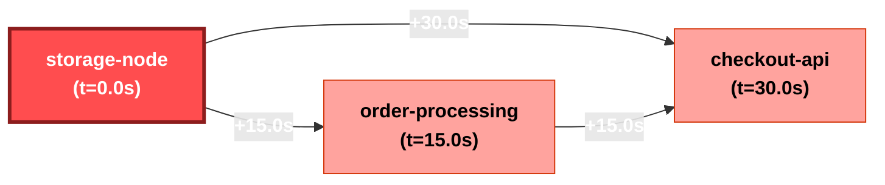

# Incident Investigation Report: INC-C58825
**Scenario**: `Scenario 4: Decoy Cache vs Real Disk Full`  
**Generated**: `2026-11-07 01:53:19 UTC`  
**Overall Severity**: `CRITICAL` (Base: Critical, LLM Adj: +0)  
**Primary Root Cause**: `storage-node`  
**Investigation Confidence**: `97.0%`

---

## 1. Executive Summary
Incident investigation identified root cause in service **`storage-node`** (Primary Root Cause: Disk Exhaustion in `storage-node`). Cascading failures propagated through 3 services. Adversarial verification determined hypothesis confidence of **97.0%** with all cited claims grounded in verified log entries.

## 2. Hybrid Severity Breakdown
A defensible weighted calculation based on system telemetry and blast impact:

| Factor | Weight | Score | Description |
| :--- | :---: | :---: | :--- |
| **Availability Impact** | 35% | 1.00 | Service downtime vs degraded operation |
| **Blast Radius** | 25% | 0.95 | Number & criticality of affected services |
| **Error Rate & Trend** | 20% | 1.00 | Peak error spike ratio and trajectory |
| **User-Facing Path** | 20% | 1.00 | Customer ingress path vs internal batch |
| **Composite Base Score** | 100% | **0.987** | Mapped Band: **Critical** |
| **Final Severity** | - | **Critical** | Justification: Deterministic formula calculated score 0.987 (Critical) based on: Availability=1.00 (35%), Blast Radius=0.95 (25%), Error Rate=1.00 (20%), User-Facing=1.00 (20%). |

## 3. Innovation 1: Auto-inferred Causal Propagation Graph
Inferred propagation graph derived from anomaly onset timestamps and inter-service error citations:

### Blast Radius Timeline
| Order | Service | Onset Timestamp | Lag from Root | Status |
| :---: | :--- | :--- | :---: | :--- |
| storage-node | `storage-node` | `2026-11-07T10:00:05` | +0.0s | **ROOT CAUSE** |
| order-processing | `order-processing` | `2026-11-07T10:00:20` | +15.0s | Cascading Cascade |
| checkout-api | `checkout-api` | `2026-11-07T10:00:35` | +30.0s | Cascading Cascade |

## 4. Innovation 2: Hypothesis Tournament with Adversarial Verifier
To prevent LLM confirmation bias, competing hypotheses were evaluated by an adversarial verification agent:

### H1: Primary Root Cause: Disk Exhaustion in `storage-node` [SUPPORTED]
- **Candidate Service**: `storage-node`
- **Description**: Failure initiated in `storage-node` due to internal fault, propagating downstream to other services.
- **Testable Predictions**:
  - `storage-node` anomaly onset timestamp must strictly precede downstream errors.
  - `storage-node` log entries must show intrinsic fatal errors or resource exhaustion.
  - Downstream service error logs must reference connection or timeout failures to `storage-node`.
- **Outcome & Evidence**: Strongly supported: Earliest onset verified with 1 intrinsic failure events. Downstream services corroborate dependency failure.
- **Confirming Citations**: L-0003, L-0004, L-0005
- **Refuting Citations**: None

### H2: Alternative Hypothesis: Independent Failure in `order-processing` [REFUTED]
- **Candidate Service**: `order-processing`
- **Description**: Failure originated independently in `order-processing` (DISK_EXHAUSTION) and was not a mere cascade from `storage-node`.
- **Testable Predictions**:
  - `order-processing` errors must begin prior to or independent of `storage-node`.
  - `order-processing` error logs should not reference `storage-node` timeouts as trigger.
  - `order-processing` must exhibit autonomous internal crash without upstream dependency failure.
- **Outcome & Evidence**: Refuted as primary root cause: Error onset in `order-processing` occurred +15.0s after `storage-node`. Logs in `order-processing` explicitly document cascading upstream failures from `storage-node`.
- **Confirming Citations**: None
- **Refuting Citations**: L-0004

### H3: Decoy / Concurrent Incident: Transient Fault in `checkout-api` [REFUTED]
- **Candidate Service**: `checkout-api`
- **Description**: `checkout-api` failure is the true root driver, or is an unrelated noisy background symptom.
- **Testable Predictions**:
  - `checkout-api` errors must persist and correlate directly with end-user degradation.
  - Mitigating `checkout-api` would restore end-to-end service availability.
- **Outcome & Evidence**: Refuted as primary root cause: Error onset in `checkout-api` occurred +30.0s after `storage-node`. Logs in `checkout-api` explicitly document cascading upstream failures from `storage-node`.
- **Confirming Citations**: None
- **Refuting Citations**: L-0005

## 5. 'Why Not X?' Competitive Hypothesis Analysis
Detailed rationale refuting alternative or decoy root causes:

- **Why Not `order-processing` (Alternative Hypothesis: Independent Failure in `order-processing`)?**
  - **Finding**: Refuted as primary root cause: Error onset in `order-processing` occurred +15.0s after `storage-node`. Logs in `order-processing` explicitly document cascading upstream failures from `storage-node`.
  - **Disproving Citations**: L-0004

- **Why Not `checkout-api` (Decoy / Concurrent Incident: Transient Fault in `checkout-api`)?**
  - **Finding**: Refuted as primary root cause: Error onset in `checkout-api` occurred +30.0s after `storage-node`. Logs in `checkout-api` explicitly document cascading upstream failures from `storage-node`.
  - **Disproving Citations**: L-0005

## 6. Grounded Evidence Citations
Every conclusion in this report links directly to immutable source log lines:

| Citation ID | Timestamp | Service | Level | Raw Excerpt |
| :---: | :--- | :--- | :---: | :--- |
| **`L-0002`** | `10:00:05` | `storage-node` | `CRITICAL` | I/O error: No space left on device (/var/data mount 100% full, inode exhaustion) |
| **`L-0003`** | `10:00:08` | `storage-node` | `ERROR` | Disk space exhaustion: write failed for transaction WAL-0994 on disk full |
| **`L-0004`** | `10:00:20` | `order-processing` | `ERROR` | Write failure when persisting order batch: upstream storage-node disk full error |
| **`L-0005`** | `10:00:35` | `checkout-api` | `ERROR` | Upstream order-processing failed: storage-node persistence error |

## 7. RAG-Retrieved Remediation Runbook
No automated runbook matched the symptom threshold. Default recovery procedures recommended.

## 8. Historical Incident Memory (RAG)
No prior matching incidents in incident memory.

## 9. Governance & Action Status
- **Action Policy**: *Recommend-only*. Automated remediation requires human SRE authorization.
- **Human Approval Status**: `PENDING APPROVAL` ⏸️
- **Audit Trail**: Every guardrail check, tool dispatch, and LLM reasoning step logged to `outputs/audit.log`.
